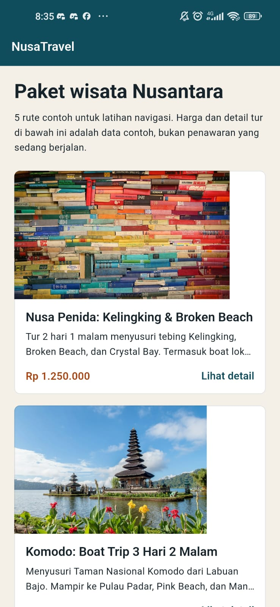
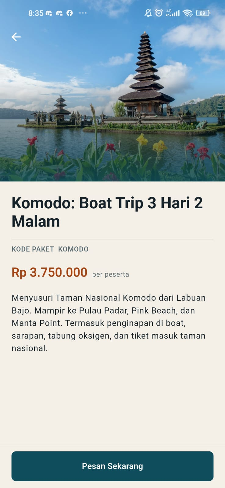
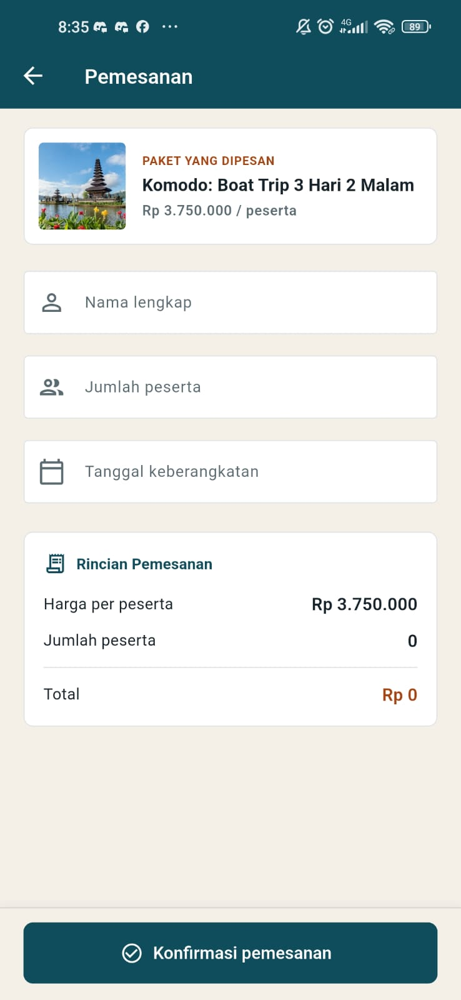

# 🌴 NusaTravel — Navigasi dan Routing Flutter

Aplikasi mobile pemesanan tur wisata Nusantara berbasis Flutter yang mengimplementasikan konsep fundamental hingga tingkat lanjut dari sistem **Navigasi dan Routing** pada Flutter.

Aplikasi ini diuji dan dijalankan langsung pada perangkat fisik Android (**Xiaomi Redmi Note 9 / M2003J15SC**).

---

## 📸 Tangkapan Layar Aplikasi (Screenshot Fitur)

Berikut adalah dokumentasi tampilan antarmuka dan alur fitur aplikasi yang diambil langsung dari perangkat HP Android yang terhubung melalui USB:

| 1. Splash Screen | 2. Katalog Paket Wisata | 3. Detail Paket Wisata | 4. Form Pemesanan |
| :---: | :---: | :---: | :---: |
|  |  |  |  |
| Halaman pembuka dengan latar hero dan transisi `pushReplacementNamed` | Katalog destinasi dengan foto beradaptasi, tarif per orang, dan aksi lihat detail | Halaman rincian paket wisata dengan `SliverAppBar` interaktif dan tombol aksi pesan | Form pemesanan lengkap dengan kartu preview paket, input berikon, dan *sticky button* |

---

## ✨ Fitur & Penerapan Konsep Navigasi

Proyek ini mendemonstrasikan secara komprehensif 4 pilar navigasi pada Flutter:

### 1. Deklarasi Route Utama (`initialRoute` & `routes`)
- **`AppRoutes.splash` (`/`)**: Halaman gerbang pembuka aplikasi. Menggunakan `Navigator.pushReplacementNamed()` saat tombol *Mulai Eksplorasi* ditekan agar halaman splash tidak menumpuk di stack navigasi.
- **`AppRoutes.home` (`/home`)**: Katalog paket wisata Nusantara.

### 2. Rute Dinamis dengan Argumen (`onGenerateRoute`)
- **`AppRoutes.detail` (`/detail`)**: Menerima objek data model `TourPackage` yang dikirimkan via `arguments` dari kartu yang ditekan di halaman katalog.
- **`AppRoutes.booking` (`/booking`)**: Alternatif pembukaan form booking secara langsung berbasis rute bernama.

### 3. Penanganan Halaman Tak Dikenal (`onUnknownRoute`)
- Setiap panggilan route yang tidak terdaftar akan secara otomatis diarahkan ke halaman **404 (Not Found Screen)** yang informatif dan menyediakan tombol navigasi kembali ke beranda.

### 4. Pengembalian Nilai & Proteksi Navigasi (`Navigator.push<T>` & `PopScope`)
- **Form Pemesanan (`BookingScreen`)**: Dibuka menggunakan `Navigator.push<BookingResult>()` untuk menunggu hasil input pengguna.
- **Pengembalian Data:** Ketika formulir divalidasi dan dikonfirmasi, data dikembalikan ke halaman pemanggil via `Navigator.pop(result)` dan ditampilkan melalui `SnackBar` konfirmasi.
- **Proteksi Data Hilang:** Menggunakan `PopScope` untuk mencegat tombol *back* perangkat fisik Android maupun tombol kembali di AppBar sehingga memunculkan dialog konfirmasi sebelum data formulir dibatalkan.
- **Reset Riwayat Halaman:** Fitur keluar akun memanfaatkan `Navigator.pushNamedAndRemoveUntil(context, AppRoutes.home, (route) => false)` untuk membersihkan seluruh tumpukan halaman.

---

## 📂 Struktur Proyek

```text
nusa_travel/
├── android/                   # Konfigurasi platform Android & izin INTERNET
├── assets/fonts/              # Font tipografi lokal (Playfair Display & Source Sans 3)
├── lib/
│   ├── models/
│   │   └── tour_package.dart  # Data model katalog paket wisata
│   ├── routes/
│   │   └── app_routes.dart    # Peta rute, onGenerateRoute, dan konstanta route
│   ├── screens/
│   │   ├── splash_screen.dart # Layar pembuka (splash)
│   │   ├── home_screen.dart   # Katalog utama paket wisata
│   │   ├── detail_screen.dart # Rincian paket & penampil SnackBar hasil
│   │   ├── booking_screen.dart# Formulir pemesanan, PopScope, & kalkulasi total
│   │   └── not_found_screen.dart # Halaman penanganan 404
│   ├── widgets/
│   │   └── destination_photo.dart # Komponen gambar dengan shimmer placeholder & error state
│   ├── theme.dart             # Tema palet warna NusaTheme & tipografi
│   └── main.dart              # Titik masuk MaterialApp & delegasi routing
├── screenshots/               # Dokumentasi tangkapan layar fitur langsung dari HP
└── test/
    └── widget_test.dart       # Pengujian komprehensif alur routing, PopScope, dan form (10/10 lulus)
```

---

## 🚀 Cara Menjalankan Proyek

### Prasyarat
- Flutter SDK (Channel `stable`, versi 3.47.5+)
- Android SDK (API Level 31+) & JDK 17 / 21
- Perangkat Android dengan mode **USB Debugging** dan **Install via USB** aktif

### Langkah Menjalankan di HP Android
1. Hubungkan HP Android ke komputer menggunakan kabel USB.
2. Pastikan perangkat terdeteksi dengan menjalankan perintah:
   ```bash
   flutter devices
   ```
3. Unduh seluruh dependensi paket:
   ```bash
   flutter pub get
   ```
4. Jalankan aplikasi ke perangkat yang terhubung:
   ```bash
   flutter run -d <device-id>
   ```

### Menjalankan Pengujian (Unit & Widget Test)
Seluruh skenario pengujian navigasi, form validasi, PopScope, dan SnackBar dapat diuji secara otomatis:
```bash
flutter test
```
```bash
flutter analyze
```

---

## 👤 Pengembang
- **Nama:** Amal Hidayah
- **Email:** `amal.hidayah_ti24@nusaputra.ac.id`
- **Program Studi:** Teknik Informatika
- **Institusi:** Universitas Nusa Putra
